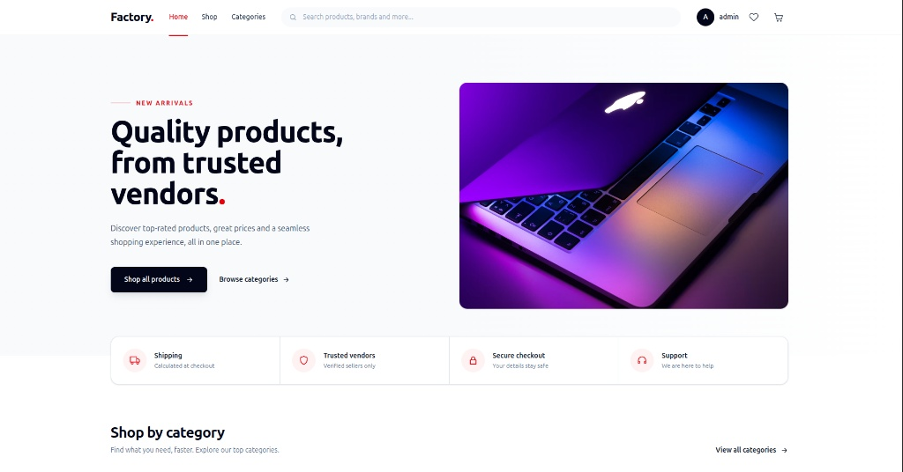
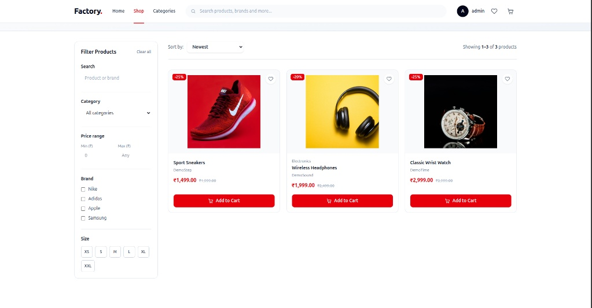
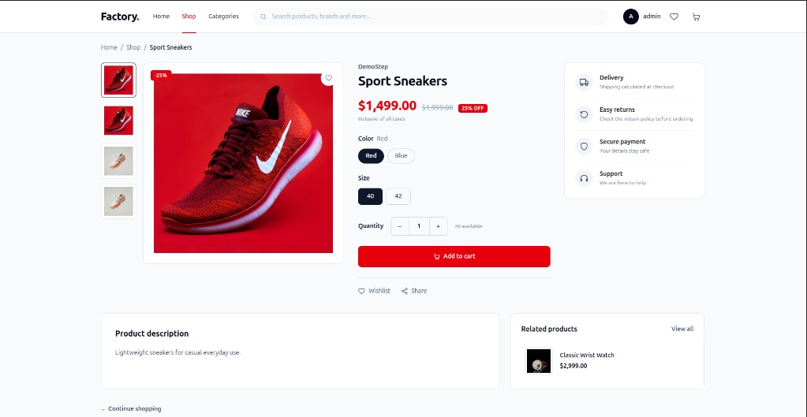
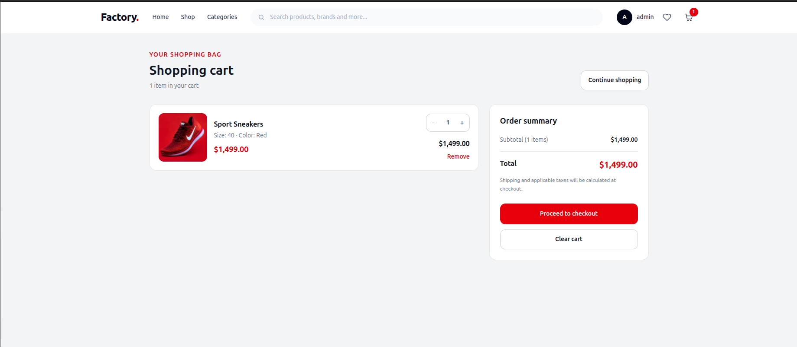
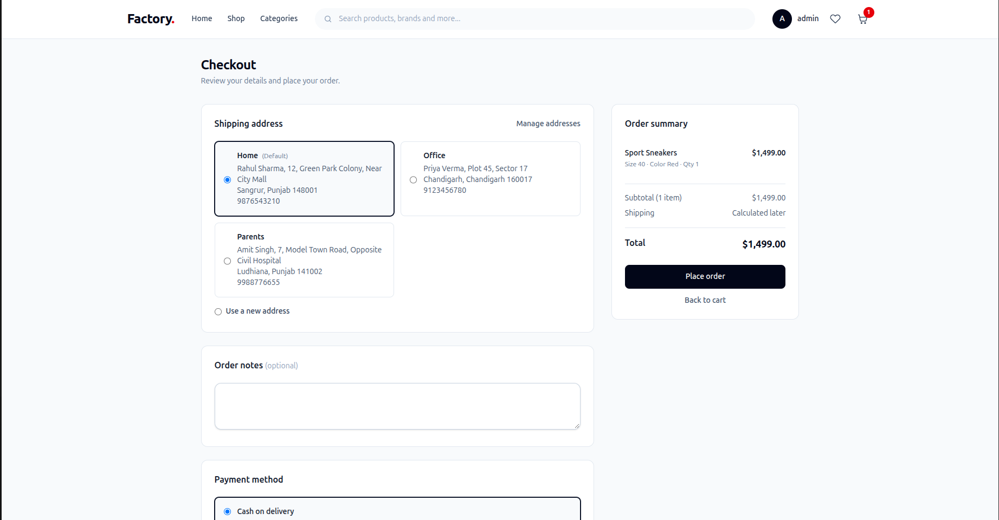

# 🛒 Multi-Vendor Ecommerce Store

A modern, full-featured multi-vendor e-commerce platform built with **Laravel**, **Livewire**, and **Filament**.

---

## 🖼️ Application Screenshots

### Complete Application Flow


<p align="center">
  
  
  
</p>

<p align="center">
  
  
</p>

---

## 📌 About the Project

The **Multi-Vendor Ecommerce Store** is a web application where multiple vendors can manage their products while customers browse products, choose available variants, add items to their cart, and proceed through checkout.

The project includes a customer-facing storefront and an administrative product-management workflow. Administrators can review vendor-submitted products and control their publishing status.

> **Note:** Features listed under [Planned Enhancements](#-planned-enhancements) are ideas for future development and should not be considered implemented yet.

---

## ✨ Features

### 🛍️ Customer Storefront
- Browse product catalog and categories with dynamic filtering.
- View detailed product pages with high-resolution image galleries.
- Interactive variant selection (Color, Size, SKU-based stock check).
- Real-time shopping cart management (add, update quantities, remove).
- Dynamic price updates and checkout workflow.

### 🏢 Vendor Product Management
- Associate products directly with vendor profiles.
- Comprehensive product details and rich descriptions editor.
- Multiple product photo uploads with primary thumbnail assignment.
- Create multi-attribute variants (Size, Color, Price, Stock, SKU).
- Direct submission process for admin authorization.

### 🛡️ Admin Panel & Moderation
- Unified dashboard powered by Filament.
- Product review queue for approving or rejecting vendor submissions.
- Status tracking (Draft, Pending Review, Published, Rejected).
- Categorization and global catalog control.

---

## 🧰 Technology Stack

| Technology | Purpose |
| :--- | :--- |
| **Laravel** | Backend application framework |
| **PHP 8.x** | Core programming language |
| **Livewire** | Dynamic reactive frontend components |
| **Blade** | Server-rendered templates |
| **Filament** | Administrative dashboard framework |
| **Tailwind CSS** | Responsive styling |
| **Laravel Filesystem** | Local/S3 media & product image storage |
| **Git & GitHub** | Version control |

---

## 🗂️ Project Structure

```text
app/
├── Filament/
│   └── Resources/
│       └── Products/
│           └── Schemas/
├── Livewire/
│   └── Storefront/
├── Models/
└── Services/

database/
├── migrations/
└── seeders/

resources/
└── views/
    ├── components/
    │   └── layouts/
    └── livewire/
        └── storefront/

docs/
└── images/
    └── horizontal_combined_preview.png
```

---

## ⚙️ Installation & Setup

### Requirements
- **PHP** `>= 8.2`
- **Composer**
- **Node.js** & **npm**
- **MySQL** or **PostgreSQL**

### 1. Clone the Repository
```bash
git clone https://github.com/your-username/factory-app.git
cd factory-app
```

### 2. Install Dependencies
```bash
composer install
npm install
```

### 3. Configure Environment
```bash
cp .env.example .env
php artisan key:generate
```
> Configure your database credentials (`DB_DATABASE`, `DB_USERNAME`, `DB_PASSWORD`) in `.env`.

### 4. Run Migrations & Seeders
```bash
php artisan migrate --seed
```

### 5. Link Public Storage
```bash
php artisan storage:link
```

### 6. Build Assets & Start Development Server
```bash
# Compile asset files
npm run dev

# Start local server (in a separate terminal)
php artisan serve
```

Aapka application `http://127.0.0.1:8000` par Live ho jayega.

---

## 🚀 Planned Enhancements

- [ ] Vendor revenue dashboard & analytics reports.
- [ ] Multi-vendor order splitting and processing.
- [ ] Integrated Payment Gateways (Stripe, Razorpay, PayPal).
- [ ] Customer account management & order history tracking.
- [ ] Automated email/SMS order status notifications.
- [ ] Product review and star rating system.

---

## 🤝 Contributing

1. **Fork** the repository.
2. Create a new feature branch (`git checkout -b feature/AmazingFeature`).
3. **Commit** your changes (`git commit -m 'Add some AmazingFeature'`).
4. **Push** to the branch (`git checkout main && git push origin feature/AmazingFeature`).
5. Open a **Pull Request**.

---

<p align="center">
  <b>Made with ❤️ Mustaak ): </b>
</p>